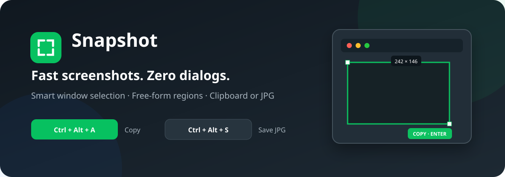

<p align="center">
  
</p>

<p align="center">
  <a href="https://github.com/wongzijie/Snapshot/releases/latest"></a>
  <a href="https://github.com/wongzijie/Snapshot/actions/workflows/build-and-release.yml"></a>
  
  
</p>

<p align="center">
  <strong>微信式选区体验 + macOS 式快捷直存。</strong><br>
  一款轻量、离线、常驻托盘的 Windows 截图工具。
</p>

<p align="center">
  简体中文 · <a href="README_EN.md">English</a>
</p>

## 为什么是 Snapshot？

大多数截图工具要么只复制到剪贴板，要么每次都弹出保存对话框。Snapshot 用两套独立的全局快捷键解决这两个高频场景：

- **复制模式**：选完即进入剪贴板，直接粘贴到聊天、文档或设计工具。
- **保存模式**：选完直接写入本地 JPG，不弹保存对话框。
- **智能窗口识别**：移动鼠标即可吸附当前窗口，也能自由拖出任意区域。
- **选区可调整**：选定后可以移动选区、拖动边缘或控制点缩放。
- **完全本地运行**：不联网、不上传截图、没有账户和遥测。

<p align="center">
  
</p>

## 下载

前往 [GitHub Releases](https://github.com/wongzijie/Snapshot/releases/latest)，下载：

```text
Snapshot-v1.0.0-win-x64.zip
```

解压后双击 `Snapshot.exe`。发布包已包含 .NET 运行时，不需要单独安装 .NET。

> [!NOTE]
> 当前版本尚未进行商业代码签名，Windows 可能显示“未知发布者”。如有顾虑，请核对 Release 页面提供的 SHA-256，或直接从源码构建。

## 快速开始

| 操作 | 默认快捷键 | 结果 |
|---|---|---|
| 截图到剪贴板 | `Ctrl + Alt + A` | 可立即在其他应用中粘贴 |
| 截图并保存 | `Ctrl + Alt + S` | JPG 直接保存到系统“下载”文件夹 |

触发快捷键后：

1. 移动鼠标，Snapshot 会自动框选鼠标下方的窗口。
2. 单击可选择整个窗口；按住左键拖动可创建自定义区域。
3. 选定后可拖动选区移动，或拖动边缘/控制点缩放。
4. 按 `Enter`、双击选区或点击绿色按钮完成。
5. 按 `Esc` 或单击鼠标右键取消。

更多说明请查看 [完整使用指南](docs/USAGE.zh-CN.md)。

## 设置

程序启动后常驻系统托盘：

- 双击绿色 Snapshot 图标打开设置。
- 右键图标可立即截图、打开保存目录或退出。
- 可分别修改两套全局快捷键。
- 可修改 JPG 保存目录和图片质量（60%–100%）。

两套快捷键必须不同，并包含 `Ctrl`、`Alt`、`Shift` 或 `Win` 中的至少一个修饰键。

## 文件位置

| 内容 | 默认位置 |
|---|---|
| JPG 截图 | Windows 系统“下载”文件夹 |
| 设置 | `%AppData%\Snapshot\settings.json` |
| 本地日志 | `%LocalAppData%\Snapshot\Snapshot.log` |

日志只记录启动、截图尺寸和错误信息，不包含截图像素或剪贴板内容。

## 从源码构建

环境要求：

- Windows 10/11 x64
- [.NET 10 SDK](https://dotnet.microsoft.com/download/dotnet/10.0)

```powershell
git clone https://github.com/wongzijie/Snapshot.git
cd Snapshot
dotnet build .\Snapshot.csproj -c Release
```

生成自包含单文件版本：

```powershell
.\build-release.ps1
```

输出位于 `dist\Snapshot.exe`。

## 当前范围

Snapshot v1.0 专注于可靠、快速的截图主流程：

- [x] 全局快捷键
- [x] 窗口识别
- [x] 自由选区
- [x] 选区移动与缩放
- [x] 剪贴板复制
- [x] JPG 快捷保存
- [x] 多显示器虚拟桌面
- [ ] 画笔、箭头与文字标注
- [ ] 马赛克
- [ ] OCR
- [ ] 截图贴图

## 参与项目

Bug 和功能建议欢迎通过 [Issues](https://github.com/wongzijie/Snapshot/issues) 提交。贡献代码前请阅读 [CONTRIBUTING.md](CONTRIBUTING.md)。

安全问题请不要创建公开 Issue，详见 [SECURITY.md](SECURITY.md)。

## 说明

Snapshot 的交互灵感来自微信截图与 macOS 系统截图，但与腾讯或 Apple 无隶属、授权或合作关系。
