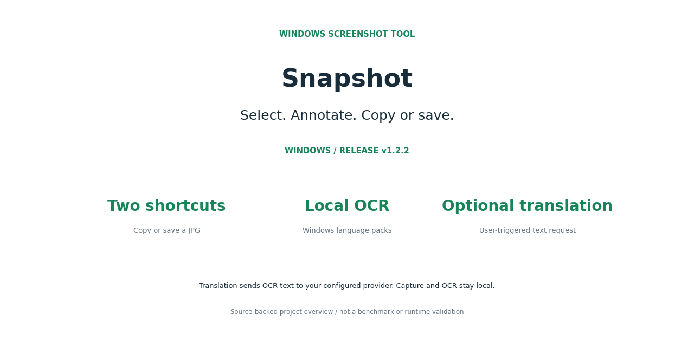
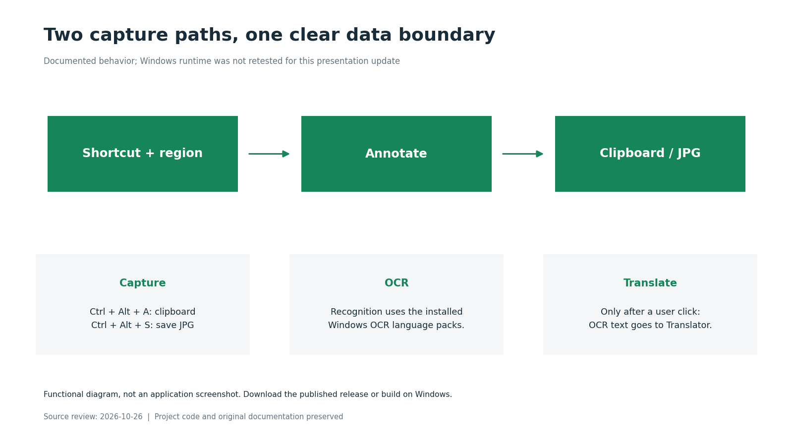

# Snapshot 图文素材

状态：**WINDOWS / RELEASE v1.2.2**。这些图片根据现有源码或文档制作，流程图属于说明图，并非运行截图；本次没有重新验证应用运行或外部服务。

## 项目封面

[查看原图](cover.png)

## 工作流程与边界

[查看原图](workflow.png)

## 社交分享封面

[查看原图](social-preview.png)

## 图中信息依据

- [README.md](https://github.com/wongzijie/Snapshot/blob/d0524b6f02cb7e18e4b4e901bf880d2189f10d74/README.md)
- [README_EN.md](https://github.com/wongzijie/Snapshot/blob/d0524b6f02cb7e18e4b4e901bf880d2189f10d74/README_EN.md)
- [docs/USAGE.zh-CN.md](https://github.com/wongzijie/Snapshot/blob/d0524b6f02cb7e18e4b4e901bf880d2189f10d74/docs/USAGE.zh-CN.md)

## 原有素材

- [hero.svg](../hero.svg)
- [workflow.svg](../workflow.svg)

图片指纹及来源版本见 [manifest.json](manifest.json)。
